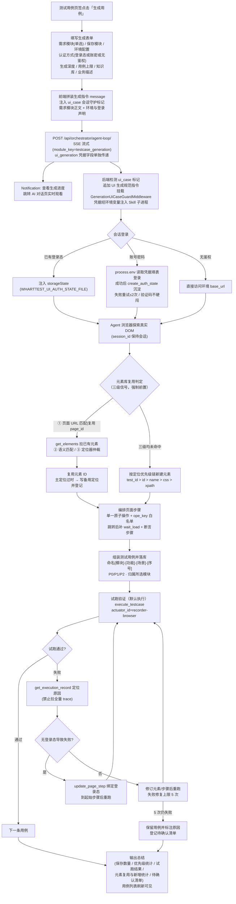

# AI 一键生成 UI 自动化测试用例 — 需求文档

| 项目 | 内容 |
|---|---|
| 功能名称 | AI 一键生成 UI 自动化用例（UI 自动化模块 / 测试用例页签） |
| 所属平台 | WHartTest 测试平台 |
| 文档版本 | v1.2 |
| 编写日期 | 2026-10-09 |
| 状态 | 已实现（master-pe 分支） |

---

## 1. 背景与目标

### 1.1 背景

UI 自动化用例的传统构建流程为：手动创建页面 → 手动提取元素 → 手动编排页面步骤 → 手动组装测试用例，单个模块的用例建设通常以天计。平台此前已在接口自动化模块落地"AI 一键生成接口用例"能力（需求模块理解 + 参数约束提取 + 生成后试跑自证），UI 自动化缺少同等效率工具。

同时，需求管理模块已支持将需求文档拆分为需求模块（`RequirementModule`），模块正文包含业务流程、接口定义、验收标准等结构化内容，可直接作为 AI 生成用例的业务输入。

### 1.2 目标

用户在 UI 自动化模块的测试用例页签点击「生成用例」，选择一个需求模块，一键触发 AI Agent：

1. 以所选需求模块内容为业务依据，自主通过真实浏览器探索目标系统页面 DOM；
2. 按平台规范提取页面元素、编排页面步骤、组装测试用例并全部落库；
3. 默认对生成的用例执行试跑验证，失败自动修复，产出可直接维护、可执行的 UI 自动化用例。

### 1.3 非目标（本期不做）

- 不支持跨多个需求模块一次性生成（每次限一个模块，避免业务面过宽；多选批量生成规划为下一期讨论）；
- 不在生成会话中处理验证码。

---

## 2. 业务流程图

---

## 3. 用户与使用场景

| 用户 | 场景 |
|---|---|
| 测试工程师 | 需求评审后，为某业务模块快速建设 UI 自动化回归用例 |
| 测试负责人 | 项目提测前批量补齐核心模块的 P0 冒烟用例 |

典型流程：选择项目 → 进入 UI 自动化模块 → 切到测试用例页签 → 点击「生成用例」（蓝色主按钮，位于「录制用例」与「新增用例」之间）→ 填写表单提交 → 在 AI 对话页跟踪进度 → 回到测试用例页签查看产物 → 人工复核。

---

## 4. 功能需求

### 4.1 功能入口

- 位置：UI 自动化模块 → 测试用例页签工具栏，「生成用例」按钮（`type="primary"` 蓝色，带机器人图标）。
- 点击弹出「AI 生成 UI 自动化测试用例」表单弹窗。

### 4.2 生成表单

| 字段 | 必填 | 说明 |
|---|---|---|
| 需求模块 | 是 | 两级级联单选：先选需求文档（仅列出已拆分模块的文档），再选该文档下的一个需求模块。模块正文作为生成业务依据 |
| 保存模块 | 是 | UI 模块树单选，生成的页面与用例均归属该模块 |
| 环境配置 | 是 | 下拉单选，默认选中项目默认环境；展示环境名称与 base_url。base_url 即生成的入口 URL（不再单独提供起始 URL 字段） |
| 认证方式 | 是 | 三选一：使用已有登录态（推荐，下拉按所选环境过滤）/ 账号密码登录 / 无鉴权。选账号密码时账密必填 |
| 生成深度 | 是 | 正向主流程（默认）/ 完整覆盖；两项均带悬停提示说明含义 |
| 用例数量上限 | 是 | 数字输入，1–30，默认 6 |
| 知识库 | 否 | 勾选后展示知识库下拉（项目内知识库），用于检索补充业务流程 |
| 业务描述 | 否 | 多行文本，最长 2000 字符，描述业务规则、页面状态、依赖关系等补充信息 |

表单校验规则：

- 未选需求模块 / 保存模块 / 环境配置时阻止提交并提示；
- 认证方式选"使用已有登录态"但该环境无登录态时，单选项自动禁用；
- 选账号密码登录时账号、密码任一为空阻止提交；
- 勾选知识库但未选择具体知识库时阻止提交。

### 4.3 提交与进度反馈

- 提交后通过 SSE 流式接口（`/api/orchestrator/agent-loop/`，`module_key=testcase_generation`）发起生成任务；
- 提交成功后右上角弹出通知「AI 生成任务已启动」，通知内提供「查看生成进度」链接，点击跳转 AI 对话页；
- 提交时同步写入知识库开关状态（`langgraph_knowledge_settings`），保证对话页的开关显示与实际一致；
- 任务完成后自动刷新 UI 自动化模块的测试用例页签。

### 4.4 生成流程（Agent 行为规范）

Agent 执行遵循系统提示词《UI 自动化用例生成规范》（与提示词管理中的「UI自动化用例生成」模板同源），核心流程：

1. **会话准备与登录**
   - 入口 URL 取环境配置 base_url；
   - 选登录态：平台将登录态 storageState 写入临时文件（0600 权限），路径经环境变量 `WHARTTEST_UI_AUTH_STATE_FILE` 注入，Agent 在浏览器进程内注入后访问入口 URL；
   - 选账密：平台将凭据经环境变量 `WHARTTEST_UI_USERNAME` / `WHARTTEST_UI_PASSWORD` 注入 Skill 子进程，Agent 在代码内以 `process.env` 读取填表登录，禁止用 shell 命令读取或复述凭据；登录成功后调用 `create_auth_state` 沉淀登录态供下次免登录；技能版本过旧无此工具时登记提示升级，禁止改用公共数据存凭据；
   - 登录失败重试上限 2 次，超限停止并询问用户；遇验证码不硬闯，建议用户改用登录态方式。

2. **页面探索与元素复用判定**
   - 通过 playwright 系 Skill（带 `session_id` 保持浏览器会话）对页面 snapshot/eval 探索真实 DOM；
   - 落库任何元素前必须先做**元素库复用判定（三级信号，强制前置）**，禁止盲目新建：
     - ① 页面级匹配（强信号）：先 `get_ui_pages` 拿已有页面清单与浏览器实际 URL 精确比对（SPA 按路由路径匹配、忽略临时参数），命中必须复用该页面 page_id，禁止重建；URL 不同才允许新建。页面名称仅作参考，不作为判定依据；
     - ② 元素语义匹配：确定页面后 `get_elements` 拉已有元素清单（名称/定位器/描述），按业务语义判断 DOM 中的元素是否即库中元素，命中直接引用元素 ID；
     - ③ 定位器仲裁：名称相近但不确定时，用 `eval` 取当前元素实际属性与库中 `locator_value` 比对，命中即复用；
   - 处理规则：复用优先；复用时发现库中主定位器与当前 DOM 不符（页面改版），不擅自覆盖主定位——用 `update_element` 将当前有效定位器写入备用定位字段并登记"建议人工确认"；三级信号均未命中才允许 `create_element` 新建；
   - 新建元素按定位优先级链选取：test_id > id > name > css > xpath；禁止绝对路径 XPath 与易变属性（style、动态 class、随机 ID）；元素名称语义化。

3. **页面步骤与用例组装**
   - 每条步骤为单一原子操作，操作方法限平台 `ope_key` 白名单（fill/click/select_option/assert_* 等），参数结构须匹配；
   - 页面跳转后必须补 `wait_load` 等待步骤；断言为断言步骤（step_type=1），预期值必须来自浏览器实际观察；
   - 用例命名 `[模块]-[功能]-[场景]-[序号]`，优先级 P0/P1/P2，用例间原子、独立、可重复；
   - 全部落库通过 ui-automation-skill 工具（会话守护中间件拦截误调接口用例工具的漂移）。

4. **试跑验证（默认执行）**
   - 默认通道：录制器浏览器（`execute_testcase --actuator_id recorder-browser --config_id <环境ID>`，后端本机无头执行）；录制器不可用时降级在线执行器重试一次；
   - 失败分析仅用 `get_execution_record`（已过滤截图），禁止拉取全量 trace（防止超大输出拖垮会话）；
   - 登录态缺失导致失败时：查询环境登录态，用 `update_page_step --auth_state_id` 绑定到业务流程起始步骤后重跑；
   - 失败修复上限 5 次；仍失败保留用例并标注原因，登记待确认清单；禁止删除已保存用例；
   - 用户在对话中明确表示跳过验证时，后续用例仅静态生成。

### 4.5 生成深度定义

| 深度 | 含义 |
|---|---|
| 正向主流程 | 仅生成验证业务正常走通的端到端主流程用例（P0 为主） |
| 完整覆盖 | 在正向主流程之上，追加表单校验（必填为空、格式非法）、边界条件、异常场景（错误凭证、错误输入）、页面状态流转（按钮可点/禁用、元素显隐）用例 |

场景取舍依据优先级：需求模块正文 > 用户业务描述 > 知识库检索（关联模糊即跳过并登记，禁止编造）。总量超出上限时按 P0 > P1 > P2 裁剪，被裁剪场景登记待补充清单。

---

## 5. 非功能需求

### 5.1 安全

- **凭据不进 LLM 上下文**：账密与登录态内容仅以环境变量/临时文件（0600）注入 Skill 子进程，不写入对话消息、不落库、不输出日志；
- 对话页密码输入框脱敏；提示词禁止 Agent 在任何输出中复述凭据；
- 账密登录成功后沉淀登录态，后续生成可免账密输入；
- 临时登录态文件按用户 + 会话隔离命名。

### 5.2 稳定性

- Skill 命令输出超 20 万字符自动截断（保险丝），任何技能动作异常都无法拖垮后端进程；
- 执行记录 Trace 查询内置过滤与截断（截图/base64 剥离 + 结构摘要）；
- 工具守护中间件保证生成会话的工具调用不漂移，拦截消息可自愈（正确处理同步/异步工具调用路径）。

### 5.3 可维护性

- 生成规范提示词为单一常量来源：提示词管理模板与运行时注入共用同一内容，不漂移；中英文模板语义对齐；
- 元素库复用机制保证资产随生成沉淀收敛：优先复用已有页面/元素，重复生成不产生重复资产；定位器漂移以备用定位方式留痕，人工可确认；
- 生成结果均为平台标准对象（页面/元素/页面步骤/用例），可在可视化界面二次编辑，支持人工复用与修改。

---

## 6. 数据与接口

### 6.1 涉及数据对象

| 对象 | 说明 |
|---|---|
| `RequirementModule` | 需求模块（业务依据输入） |
| `UiModule` / `UiPage` / `UiElement` / `UiPageSteps` / `UiPageStepsDetailed` / `UiTestCase` / `UiCaseStepsDetailed` | UI 自动化产物对象 |
| `UiEnvironmentConfig` / `UiAuthState` | 环境配置与登录态 |
| `ChatSession` / `ChatMessage` | 生成过程的对话会话（进度与总结载体） |

### 6.2 关键接口

| 接口 | 用途 |
|---|---|
| `POST /api/orchestrator/agent-loop/` | 发起生成任务（SSE 流式），请求体含 `ui_generation`（env_config_id / auth_state_id / username / password） |
| `GET /api/requirements/documents/`、`/api/requirements/modules/` | 需求文档与模块级联数据 |
| `GET /api/ui-automation/env-configs/`、`/auth-states/`、`/modules/tree/` | 环境、登录态、模块树数据 |
| ui-automation-skill 工具 | Agent 落库与试跑（get/create/update 系列、execute_testcase、get_execution_record、get_auth_states、create_auth_state） |

### 6.3 技能包变更（ui-automation-skill）

- 新增 `get_auth_states`（按环境列登录态，剥离 state_json 内容）；
- 新增 `create_auth_state`（从 storageState 文件创建登录态）；
- `update_page_step` 新增 `--auth_state_id` / `--clear_auth_state`（步骤绑定/清空登录态）；
- `get_execution_trace` 内置过滤与截断；
- SKILL.md 同步执行通道选择（recorder-browser / 远程执行器）说明。

---

## 7. 验收标准

1. 「生成用例」按钮位于测试用例页签工具栏，蓝色主按钮带机器人图标；表单各字段按 4.2 定义展示与校验；两个深度选项悬停可见说明气泡；
2. 提交后通知含跳转按钮，对话页知识库开关与表单一致；
3. 账密模式下：后端日志、对话消息、生成产物中均无明文凭据；
4. 登录态模式：生成全程免登录；账密模式：登录成功后产生新登录态记录；
5. 生成产物：页面、元素、页面步骤、用例全部落库且归属所选模块；命名、定位方式、等待步骤、断言符合 4.4 规范；
6. 元素库复用：重复生成同一模块时，已有页面/元素被复用而非重复创建；库中定位器过时（与当前 DOM 不符）时写入备用定位并登记，最终总结含复用/新增统计；
7. 试跑：默认走录制器浏览器通道；失败自动修复（≤5 次）；全程无超大工具输出导致的进程卡死或服务崩溃；
8. 用户在对话中说"跳过验证"后，剩余用例静态生成并说明。

---

## 8. 风险与后续规划

| 项 | 说明 |
|---|---|
| 批量生成 | 目前一次一个需求模块；后续可评估按文档多模块队列生成 |
| 验证码场景 | 生成会话不处理验证码；依赖登录态采集流程兜底 |
| 数据参数化 | 用例数据外置/参数化（Excel/CSV 导入）随平台 parametrize 能力后续增强 |
