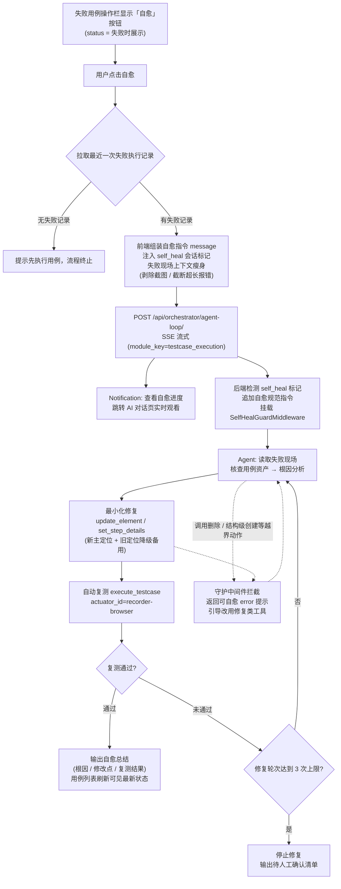

# UI 自动化用例智能自愈功能需求文档

| 项目 | 内容 |
|---|---|
| 文档版本 | v1.0 |
| 编写日期 | 2026-10-08 |
| 所属模块 | UI 自动化（测试用例）/ AI 编排（Agent Loop） |
| 关联功能 | 用例管理「智能双模执行」（参考实现）、AI 一键生成 UI 用例 |
| 状态 | 已实现，待联调验收 |

---

## 1. 背景与目标

### 1.1 背景

UI 自动化用例的执行失败中，相当一部分并非产品缺陷，而是**测试资产过期**：页面结构变化导致元素定位失效（XPath/CSS 改变）、步骤关联的元素错误、页面跳转后缺少等待等。当前失败后需要用户人工查看执行记录、分析报错、手动修改元素定位与步骤绑定，处理成本高、重复劳动多。

用例管理模块的「智能双模执行」已验证了可行路径：脚本执行失败后自动唤起 LangGraph Agent，使用 ui-automation-skill 工具诊断并修复用例资产，再自动二次执行验证。本功能将该能力引入 UI 自动化模块，作为**用户主动触发的自愈入口**。

### 1.2 目标

- UI 自动化用例执行失败后，用户可一键发起 AI 自愈，无需人工分析报错与手动改资产。
- Agent 在受控会话内完成：失败诊断 → 最小化修复 → 自动复测验证 → 自愈总结输出。
- 修复动作有护栏约束：只允许修改目标用例相关资产，禁止删除与结构级变更。

### 1.3 非目标（本期不做）

- 失败后无需用户点击的「自动触发自愈」（智能双模 hybrid 模式已覆盖该场景，本功能是 UI 自动化模块的手动入口）。
- 批量自愈、定时自愈。
- 自愈过程留痕到独立任务表（进度复用 AI 对话会话）。

---

## 2. 用户交互流程

### 2.1 业务流程图

### 2.2 入口与前置条件

- **入口**：UI 自动化 → 测试用例页签 → 用例列表操作栏「自愈」按钮。
- **显示条件**：仅当用例最近执行状态为「失败」（status === 3）时显示；图标为 Arco `icon-robot`，警示橙色文字按钮，位于「执行」与「编辑」之间。
- **防并发**：同一用例自愈请求进行中时按钮呈 loading 并禁用（`healingIds` 状态）。

### 2.3 主流程

1. 用户点击「自愈」按钮。
2. 前端调用执行记录接口，拉取该用例**最近一次失败执行记录**（含逐步结果 `step_results`、整体报错 `error_message`、环境快照 `environment`）。
   - 若无失败记录：提示「未找到该用例的失败执行记录，请先执行用例」，流程终止。
3. 前端组装自愈指令（message），内容包括：
   - 会话标记 `<!-- wharttest:generation_mode=self_heal -->`（后端据此挂载守护中间件与自愈规范提示词）；
   - 目标用例信息（项目 ID、UI 用例 ID、名称、模块、描述）；
   - 失败现场（执行记录 ID、整体报错、环境地址、失败步骤、步骤执行流水）。
   - **上下文瘦身**：剥除 base64 截图等大字段；单条报错截断（保留头尾 70%/30%，中间省略）；步骤流水仅保留最近 20 步。
4. 通过 `POST /api/orchestrator/agent-loop/`（SSE 流式）发送给 Agent，`module_key=testcase_execution`（与智能双模自愈一致，复用该 LLM 槽位配置）。
5. 任务启动成功后弹出 Notification（含「查看自愈进度」链接），点击跳转 AI 对话页（`LangGraphChat`）实时观看 Agent 工具调用与修复过程；同时写入 `langgraph_session_id` 供对话页恢复会话。
6. Agent 按自愈规范执行（见第 3 节），完成后在对话页输出自愈总结。
7. 自愈涉及资产变更，用户回到用例列表刷新后可见最新状态；复测结果反映在用例执行状态与最新执行记录中。

### 2.4 异常路径

| 场景 | 行为 |
|---|---|
| 未选择项目 | 提示先选择项目，流程终止 |
| 无失败执行记录 | 提示先执行用例，流程终止 |
| 拉取失败记录接口异常 | 提示「自愈任务启动失败」，按钮恢复可用 |
| Agent 流启动失败 | 由 chatService 统一错误提示 |

---

## 3. Agent 自愈行为规范（后端指令，单一来源）

Agent 会话系统提示词追加 `SELF_HEAL_INSTRUCTION`（`orchestrator_integration/self_heal_instructions.py`），核心约束：

### 3.1 自愈流程

1. **读取失败现场**：优先使用 message 内上下文；补充细节用 `get_execution_record`（禁止 `get_execution_trace --refresh`，防止超大 trace 撑爆上下文）。
2. **核查用例资产**：`get_page_steps` / `get_page_step` / `get_elements` 查看步骤编排与元素主/备用定位。
3. **根因分析**：区分元素定位失效 / 步骤元素绑定错误 / 页面结构变更 / 其他。
4. **最小化修复**：
   - 定位失效 → 先用浏览器工具（playwright-cli snapshot/eval）验证新定位唯一可见，再 `update_element`；更新主定位时原定位降级写入备用组（locator_type_2，被占用则 locator_type_3），不覆盖既有备用定位。
   - 绑定错误 → `set_step_details` / `update_page_step` 修正元素关联；缺元素先 `create_element` 入库。
   - 仅做恢复可执行的最小修改，禁止重构或扩充用例范围。
5. **自动复测**：`execute_testcase --actuator_id recorder-browser --wait_result`（录制器浏览器通道）；全步骤通过才算自愈成功；仍失败则继续分析修复，**总修复轮次上限 3 次**。
6. **输出总结**：固定格式（自愈结论 / 失败根因 / 修改点清单 / 复测结果 / 待人工确认）。

### 3.2 修复规则

- 定位方式优先级链：test_id > id > name > css > xpath；禁止绝对路径 XPath 与易变属性（style、动态 class、随机 ID）。
- 新定位必须先验证再写入，禁止凭猜测修改。
- 只允许触碰目标用例（case_id）引用的页面、元素与步骤；禁止删除任何对象；禁止新建测试用例/页面步骤。
- 复测必须走平台执行通道，禁止用浏览器会话自行回放代替。

---

## 4. 后端守护（SelfHealGuardMiddleware）

自愈会话挂载 `SelfHealGuardMiddleware`（`orchestrator_integration/generation_guard.py`），在工具执行层（wrap_tool_call）拦截 `execute_skill_script` 的越界 `--action`，命中返回可自愈的 error ToolMessage 引导模型改用修复类工具：

| 拦截类别 | 动作示例 | 引导方向 |
|---|---|---|
| 删除类 | delete_element / delete_page / delete_page_step / delete_testcase / batch_delete_* | 改用 update_* 修正 |
| 结构级创建 | create_testcase / create_page_step / create_page / set_case_steps / copy_testcase / batch_create_elements | 仅修复现有资产 |
| 工具漂移 | create_interface_case / update_interface_case / run_interface_case / copy_interface_case | 改用 ui-automation 工具或 execute_testcase 复测 |

放行范围：查询类（get_*）、修复类（update_element / update_page_step / set_step_details）、单个 create_element、复测（execute_testcase）。

模式识别：`detect_generation_mode` 支持四类标记，interface_case > ui_case > self_heal 优先级依次（保持历史行为不变）。自愈指令与守护在**主流式路径与 HITL resume 路径**均生效。

---

## 5. 涉及接口与数据

| 交互 | 协议 | 说明 |
|---|---|---|
| 拉取失败记录 | REST `GET /api/ui-automation/execution-records/?test_case={id}&status=3&page_size=1` | 列表取最新一条，再按 id 取详情（含 step_results） |
| 发起自愈 | SSE `POST /api/orchestrator/agent-loop/` | body 含 message（带 self_heal 标记）、project_id、module_key=testcase_execution、use_knowledge_base=false |
| 修复资产 | REST（skill 工具回调，X-API-Key） | PATCH `elements/{id}/` 等 `/api/ui-automation/` 资源接口 |
| 复测执行 | WebSocket `/ws/ui/web/`（`u_test_case` / `u_case_result`） | 由 skill 的 execute_testcase 发起，actuator_id=recorder-browser |
| 进度查看 | SSE 事件流 | AI 对话页（LangGraphChat）消费 activeStreams 渲染工具调用与总结 |

**LLM 配置**：复用 `testcase_execution` 槽位（「用例执行」），无新增配置项、无数据库迁移。

**提示词模板**：`prompts/default_templates/zh.py` 注册「UI自动化用例自愈」模板，content 与运行时指令引用同一常量，保证不漂移。

---

## 6. 验收要点

1. 执行一条 UI 用例使其失败（如改坏元素定位），列表该用例出现「自愈」按钮。
2. 点击自愈 → Notification 出现 → 跳转 AI 对话页可看到 Agent 依次调用查询、update_element、execute_testcase 工具。
3. Agent 修复后自动复测，复测通过后用例状态刷新为通过，且原定位已降级为备用定位（元素库可见）。
4. 自愈会话中诱导 Agent 调用 delete_* / create_testcase 等动作被拦截并返回引导提示。
5. 无失败记录的用例点击自愈（正常不显示按钮，接口兜底）提示先执行用例。
6. 英文环境下按钮与提示文案正常显示（Heal / Healing 等）。

---

## 7. 改动文件清单

**后端（WHartTest_Django）**

| 文件 | 变更 |
|---|---|
| `orchestrator_integration/self_heal_instructions.py` | 新增：自愈规范提示词单一来源 + 模板名/描述常量 |
| `orchestrator_integration/generation_guard.py` | 修改：self_heal 标记、detect_generation_mode 分支、SelfHealGuardMiddleware |
| `orchestrator_integration/agent_loop_view.py` | 修改：主流式路径与 resume 路径接入自愈模式（追加指令 + 挂载中间件） |
| `prompts/default_templates/zh.py` | 修改：注册「UI自动化用例自愈」提示词模板（同源常量） |
| `orchestrator_integration/test_self_heal_guard.py` | 新增：12 个单测（标记检测 / 拦截放行 / 模板同源） |

**前端（WHartTest_Vue）**

| 文件 | 变更 |
|---|---|
| `src/features/ui-automation/services/uiSelfHeal.ts` | 新增：失败记录拉取、消息拼装（上下文瘦身）、任务启动封装 |
| `src/features/ui-automation/views/TestCaseList.vue` | 修改：自愈按钮（失败态显示）、healTestCase 逻辑、防并发、Notification 跳转、中英文词条、操作列加宽 |

**依赖说明**：`module_key` 复用 `testcase_execution` 槽位，无新增 LLM 配置与迁移；已知存量问题 `ActuatorList.vue` 存在一个与本次无关的类型错误，未处理。
